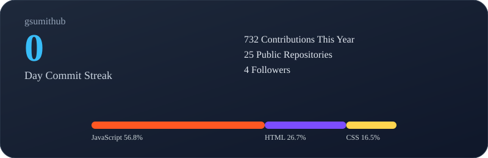

<!-- Banner -->
<!-- 

  

 -->
<h1 align="center">✨ Sumit Kumar — MERN Stack Developer ✨</h1>

  

---

## 🧑‍💻 About Me  

I'm a **Full-Stack Developer** & **B.Tech CSE graduate** passionate about crafting high-performance user interfaces, robust backend architectures, and production-ready web applications.  

Recently contributed to building scalable web platforms and monetization engines at **Sorsiri**, specializing in seamless third-party integrations and modern frontend performance.

I focus on:
- 🎨 **Modern, High-Performance UI:** Fluid animations, sub-second load times, and pixel-perfect responsiveness (React, Next.js, Vite)  
- ⚡ **Scalable Backend Systems:** RESTful microservices, secure authentication, and webhook architectures (Node.js, Express)  
- 🗄️ **Multi-Database Architectures:** Scalable schema design across both Relational and NoSQL databases (PostgreSQL, MongoDB, MySQL, Redis)  
- 💳 **Monetization & API Integrations:** Payment gateway workflows (Razorpay SDK), CRM pipelines, and telemetry systems  
- 🐳 **DevOps & Clean Architecture:** Containerization with Docker, modular MVC patterns, and clean, type-safe code  

---

## 🛠️ Tech Stack  

  

---

<!--## 📊 GitHub Analytics (Self-Hosted)

  

-->

---

## 🐍 Contribution Snake  (Self-Hosted)

  

---

## 🧩 My Web Dev Projects

<table>
  <thead>
    <tr>
      <th align="center">Project</th>
      <th align="center">Preview</th>
      <th align="center">Live Demo</th>
    </tr>
  </thead>
  <tbody>
    <tr>
      <td align="center"><strong>Gourmet AI – Recipe Assistant</strong></td>
      <td align="center"></td>
      <td align="center"><a href="https://recipe-ai-assistant-woad.vercel.app/">🚀 Live</a></td>
    </tr>
    <tr>
      <td align="center"><strong>QuizMaster</strong></td>
      <td align="center"></td>
      <td align="center"><a href="https://quizmaster-client.vercel.app/">🚀 Live</a></td>
    </tr>
    <tr>
      <td align="center"><strong>Full-Stack Furniture E-Commerce Platform</strong></td>
      <td align="center"></td>
      <td align="center"><a href="https://furniture-website-re1j.vercel.app/">🚀 Live</a></td>
    </tr>
    <tr>
      <td align="center"><strong>Enquiry Management System</strong></td>
      <td align="center"></td>
      <td align="center"><a href="https://gsumithub.github.io/Enquiry-Management-System/">🚀 Live</a></td>
    </tr>
    <tr>
      <td align="center"><strong>E-Commerce App (React + Tailwind CSS)</strong></td>
      <td align="center"></td>
      <td align="center"><a href="https://gsumithub.github.io/E-Commerce-App/">🚀 Live</a></td>
    </tr>
    <tr>
      <td align="center"><strong>Law Prep Tutorial Clone (Bootstrap + jQuery)</strong></td>
      <td align="center"></td>
      <td align="center"><a href="https://gsumithub.github.io/Law-prep-clone-bootstrap-jQuery/">🚀 Live</a></td>
    </tr>
    <tr>
      <td align="center"><strong>Solachey (Bootstrap + jQuery)</strong></td>
      <td align="center"></td>
      <td align="center"><a href="https://gsumithub.github.io/Solachey-clone-Bootstrap-jquery/">🚀 Live</a></td>
    </tr>
    <tr>
      <td align="center"><strong>Movie App</strong></td>
      <td align="center"></td>
      <td align="center"><a href="https://gsumithub.github.io/Movie-App/">🚀 Live</a></td>
    </tr>
    <tr>
      <td align="center"><strong>Diavo Jewelries Funnel</strong></td>
      <td align="center"></td>
      <td align="center"><a href="https://diavo-jweleries-funnel.vercel.app/">🚀 Live</a></td>
    </tr>
    <tr>
      <td align="center"><strong>Dialysis On Going</strong></td>
      <td align="center"></td>
      <td align="center"><a href="https://dialysis-on-going.vercel.app/">🚀 Live</a></td>
    </tr>
    <tr>
      <td align="center"><strong>Smart City Mohali Clone</strong></td>
      <td align="center"></td>
      <td align="center"><a href="https://gsumithub.github.io/Smart-City-Mohali_Clone/">🚀 Live</a></td>
    </tr>
    <tr>
      <td align="center"><strong>Blinkit Clone</strong></td>
      <td align="center"></td>
      <td align="center"><a href="https://blinkit-clone-smoky-theta.vercel.app/">🚀 Live</a></td>
    </tr>
    <tr>
      <td align="center"><strong>Count Down</strong></td>
      <td align="center"></td>
      <td align="center"><a href="https://gsumithub.github.io/Count-Down/">🚀 Live</a></td>
    </tr>
    <tr>
      <td align="center"><strong>Digital Clock</strong></td>
      <td align="center"></td>
      <td align="center"><a href="https://gsumithub.github.io/Digital-Clock/">🚀 Live</a></td>
    </tr>
    <tr>
      <td align="center"><strong>To Do List</strong></td>
      <td align="center"></td>
      <td align="center"><a href="https://gsumithub.github.io/ToDoList/">🚀 Live</a></td>
    </tr>
    <tr>
      <td align="center"><strong>Spotify Clone</strong></td>
      <td align="center"></td>
      <td align="center"><a href="https://gsumithub.github.io/Spotify_Clone/">🚀 Live</a></td>
    </tr>
    <tr>
      <td align="center"><strong>Myntra Clone</strong></td>
      <td align="center"></td>
      <td align="center"><a href="https://gsumithub.github.io/Myntra_clone/">🚀 Live</a></td>
    </tr>
    <tr>
      <td align="center"><strong>IIP Website Clone</strong></td>
      <td align="center"></td>
      <td align="center"><a href="https://gsumithub.github.io/IIP_clone/">🚀 Live</a></td>
    </tr>
    <tr>
      <td align="center"><strong>Figma to HTML</strong></td>
      <td align="center"></td>
      <td align="center"><a href="https://gsumithub.github.io/Figma_to_HTML-project-WS-Cube-Tech-web-page-/">🚀 Live</a></td>
    </tr>
    <tr>
      <td align="center"><strong>Packshifts Clone</strong></td>
      <td align="center"></td>
      <td align="center"><a href="https://gsumithub.github.io/Packshifts_clone/">🚀 Live</a></td>
    </tr>
    <tr>
      <td align="center"><strong>Solachey Clone</strong></td>
      <td align="center"></td>
      <td align="center"><a href="https://gsumithub.github.io/Solachey_clone/">🚀 Live</a></td>
    </tr>
  </tbody>
</table>

## 🌐 Socials & Badges  

  
  
  

---

## 📫 Connect With Me  

  
  

---

  ✨ Thanks for visiting — I’m always building something cool. Stay tuned! ✨

